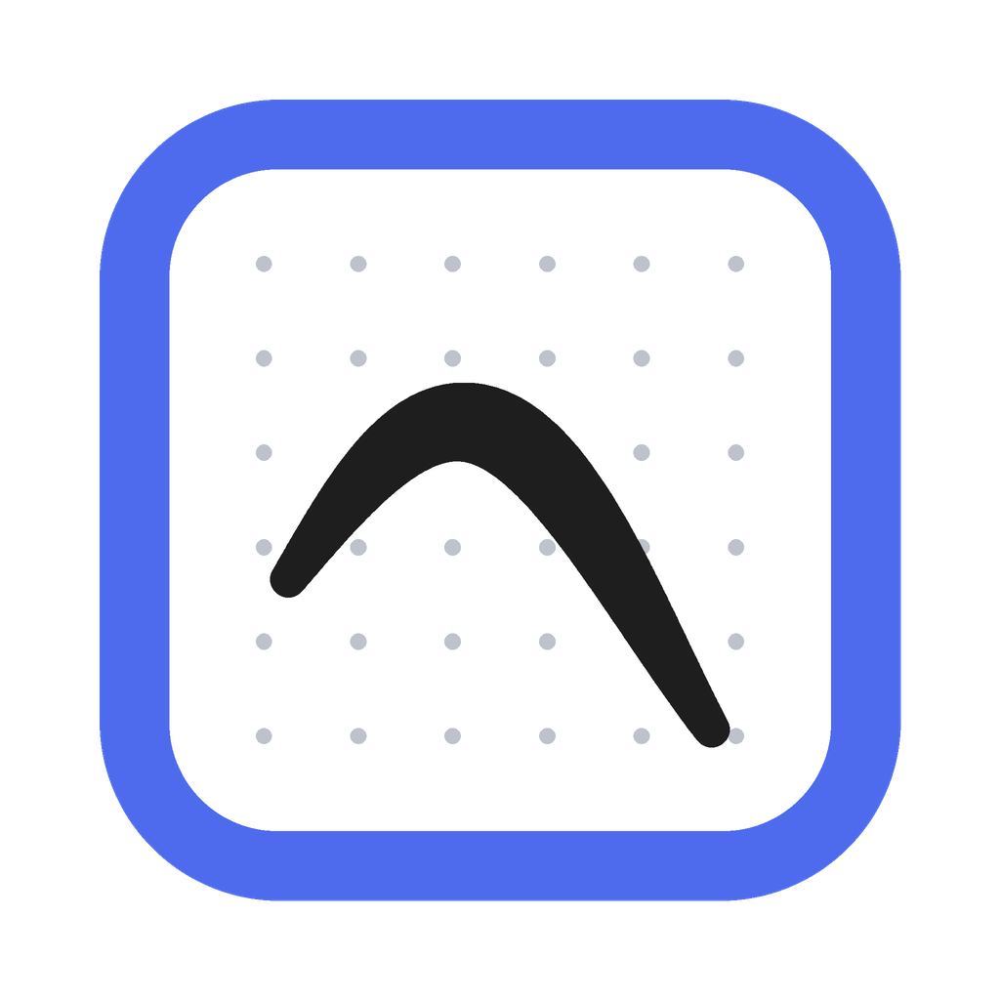
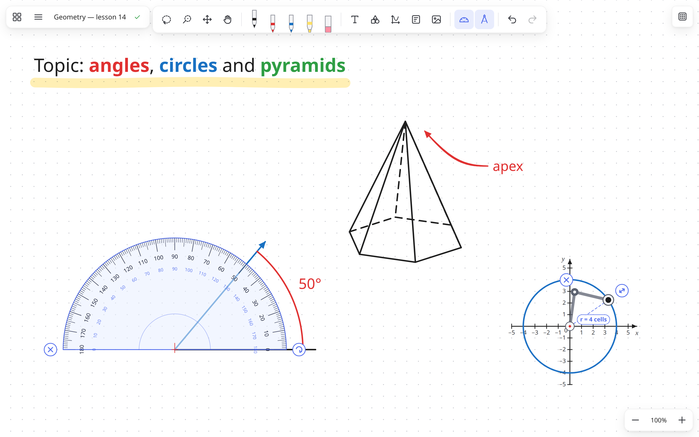
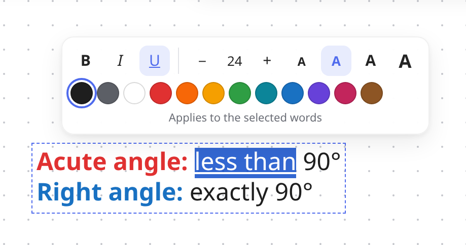
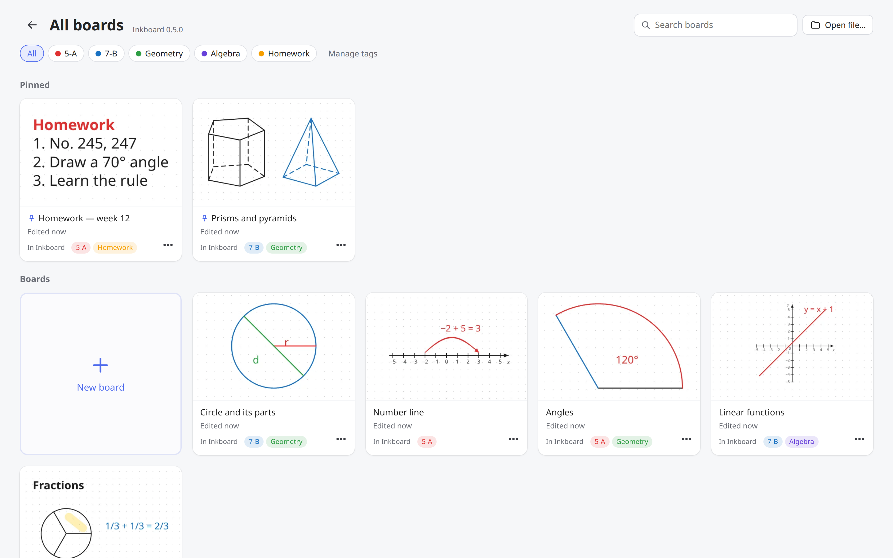

<div align="center">



# Inkboard

**A free whiteboard for teachers who write and draw with a pen tablet.**<br>
Infinite board, pressure-sensitive vector ink, a protractor and a compass, shapes and coordinate axes for maths.

[](https://github.com/yaroslavyushchenko/inkboard/releases/latest)
[](https://github.com/yaroslavyushchenko/inkboard/releases)
[](https://github.com/yaroslavyushchenko/inkboard/actions/workflows/ci.yml)
[](https://github.com/yaroslavyushchenko/inkboard/actions/workflows/release.yml)
[](LICENSE)


[](https://github.com/yaroslavyushchenko/inkboard/releases/latest)
[](https://github.com/yaroslavyushchenko/inkboard/releases/latest)
[](https://github.com/yaroslavyushchenko/inkboard/releases/latest)

**[Website](https://yaroslavyushchenko.github.io/inkboard/)** ·
**[Download](https://github.com/yaroslavyushchenko/inkboard/releases/latest)** ·
**[What's new](CHANGELOG.md)** ·
**[Keyboard shortcuts](docs/SHORTCUTS.md)** ·
**[Українською](README.uk.md)**



</div>

## Why Inkboard

Microsoft Whiteboard was the go-to board for many teachers with a pen tablet, and it's being retired.
Inkboard aims to feel just as simple (open it and write) while adding the tools a maths or science
lesson needs. It works fully offline, needs no account, and your boards stay on your computer.

## Features

**Writing and drawing**
- Infinite board: pan and zoom in any direction
- Pressure-sensitive **vector** ink that stays sharp at any zoom
- Pens, highlighter, stroke eraser; the pen's eraser end and barrel button work too
- Pen hover indicator and palm rejection
- Paper: blank, dots, grid or lines

**For maths lessons**
- **Protractor:** draw an angle from its centre or an arc along its edge; the degrees are written next to the arc
- **Compass:** set the radius (shown in paper cells) and draw arcs or full circles
- Shapes: lines, polygons, circles, and pyramids / prisms with **any number of sides** for the base, still editable after drawing
- Number lines, coordinate planes and 3D axes
- Shift for straight lines; drag a line's end to change its length and angle (whole degrees on the protractor)
- Arrows and dots on line ends, including freehand lines

**Text and pictures**
- Type right on the board; select words to change their colour, size, **bold**, *italic*, underline
- Paste pictures and screenshots (Ctrl+V), drag them in, or insert from a file

<p align="center"></p>

**Organising**
- Lasso and brush selection: move, scale, duplicate, group, lock
- Templates: save part of a board and reuse it in other lessons
- **All boards** screen with previews, search, pins and colour tags (e.g. a class or a subject)

<p align="center"></p>

**Never lose work**
- Every board saves itself within seconds, so nothing is lost even if the power goes out
- Version history, and *Recently deleted* for 30 days
- Optional backup folder (a USB stick or a Google Drive / OneDrive folder)
- Export to PNG or vector PDF; save a board as an `.inkboard` file to share it

**And also**
- Automatic updates (Windows, Linux AppImage); a new-version notice on macOS
- English and Ukrainian interface
- Works with Wacom tablets, including side buttons and ExpressKeys ([see below](#wacom-tablets))

## Download and install

Get the latest version from the **[Releases page](https://github.com/yaroslavyushchenko/inkboard/releases/latest)**:

| System | File | Notes |
|---|---|---|
| Windows 10 / 11 | `Inkboard-Setup-…-x64.exe` | Windows may warn about an unknown publisher (the app isn't code-signed yet): **More info → Run anyway** |
| macOS (Intel and Apple silicon) | `Inkboard-…-mac-universal.dmg` | Not notarized by Apple yet: if macOS blocks the first launch, open **System Settings → Privacy & Security → Open Anyway** |
| Linux | `Inkboard-…-x86_64.AppImage` or `.deb` | AppImage: allow it to run (file Properties → *Executable as Program*, or `chmod +x`), then open it |

After that Inkboard updates itself on Windows and with the AppImage; on macOS and with the `.deb` it tells you when a new version is out.

## Controls

| Action | Input |
|---|---|
| Draw | pen / left mouse button |
| Erase | eraser tool, pen eraser end, or pen barrel button |
| Pan | wheel / touchpad scroll, middle or right mouse drag, Space + drag, one finger |
| Zoom | Ctrl + wheel, touchpad pinch, two-finger pinch, Ctrl + / Ctrl − / Ctrl+0 |
| Tools | 1 / 2 / 3 pens, H highlighter, E eraser |
| Undo / Redo | Ctrl+Z / Ctrl+Y (Ctrl+Shift+Z) |
| Insert image | Ctrl+V, drag a file in, or the toolbar button |
| Lasso select | V; Del deletes, Ctrl+D duplicates, Ctrl+C / Ctrl+V copy & paste |
| Brush select | C: touch items with the circle to add them; mouse wheel = circle size; Ctrl / Alt + drag removes |
| Straight line | hold Shift while drawing |
| Group / ungroup | Ctrl+G / Ctrl+Shift+G |
| Change a line's angle / length | select it (V or M) and drag one of its round end handles |
| Stretch a shape | select it and drag a side handle; *Shape* on the selection bar changes kind / base |
| Text | **T** button in the toolbar: click and type, Esc when done; double-click text to edit; select words (or right-click) for colour / size / bold / italic / underline |
| Protractor | T: draw from the centre for an angle, along the edge for an arc (its degrees are written next to it) |
| Compass | K: drag ↔ to set the radius, then drag the pencil around the needle (a full turn = circle) |
| Lock / unlock | *Lock* on the selection bar |
| Move tool (drag anything) | M |
| Swap pen ↔ eraser | X |
| All boards | Ctrl+H |
| New board / Open file | Ctrl+N / Ctrl+O |
| Save as file | Ctrl+S (draft) or Ctrl+Shift+S |

The full list is in [docs/SHORTCUTS.md](docs/SHORTCUTS.md) and in the app (Settings → *Keyboard shortcuts*).

## Wacom tablets

- **Pen side buttons:** in Wacom Center set the lower switch to *Right click* and the upper to *Middle click*;
  then choose what each does in Inkboard (Settings → Pen buttons: eraser, lasso, or the current tool).
  To move the board with a pen button, give it the *Space* keystroke instead (hold = move).
  The settings panel has a tester that shows which button Inkboard receives.
- **ExpressKeys** on the tablet are configured in Wacom Center as *Keystroke…*, for example Ctrl+Z, X, V, M, Space.
  Settings → *Keyboard shortcuts & Wacom ExpressKeys* lists every shortcut.

## Where boards are stored

- Boards you never saved as a file live in the app's data folder
  (`%APPDATA%/Inkboard/Library` on Windows, `~/.config/Inkboard/Library` on Linux,
  `~/Library/Application Support/Inkboard/Library` on macOS).
- "Save as file…" turns a board into a normal `.inkboard` file anywhere you like; it keeps
  autosaving into that file.
- Every write is crash-safe (temp file + fsync + atomic rename, previous version kept as `.bak`).

## Feedback

Found a bug or missing something for your lessons?
[Open an issue](https://github.com/yaroslavyushchenko/inkboard/issues/new/choose) in English or Ukrainian.
See [CONTRIBUTING.md](CONTRIBUTING.md) if you'd like to help with code or translations.
The roadmap is in [docs/PLAN.md](docs/PLAN.md).

## Development

Built with Electron, React and TypeScript; the board is a custom Canvas 2D engine
(`src/renderer/src/engine`). Requires Node.js (LTS or newer).

```bash
npm install
npm run dev        # start the app with hot reload
npm run dev:x11    # Linux/Wayland: use this if pen pressure doesn't work
npm run typecheck
npm test
npm run build
```

> npm 11+ may skip Electron's install script. If `npm run dev` says Electron failed to install,
> run `node node_modules/electron/install.js` once.

### Building installers

```bash
npm run dist:linux   # AppImage + .deb + snap (needs snapcraft, see docs/SNAP.md)
npm run dist:win     # Windows NSIS installer (best built on Windows / CI)
npm run dist:mac     # macOS .dmg (must be built on a Mac / CI)
```

Releases are built by GitHub Actions: push a tag like `v0.1.0` and the
[Release workflow](.github/workflows/release.yml) builds every platform and publishes a release.

## License

Inkboard is free software: [GPL-3.0-or-later](LICENSE).
