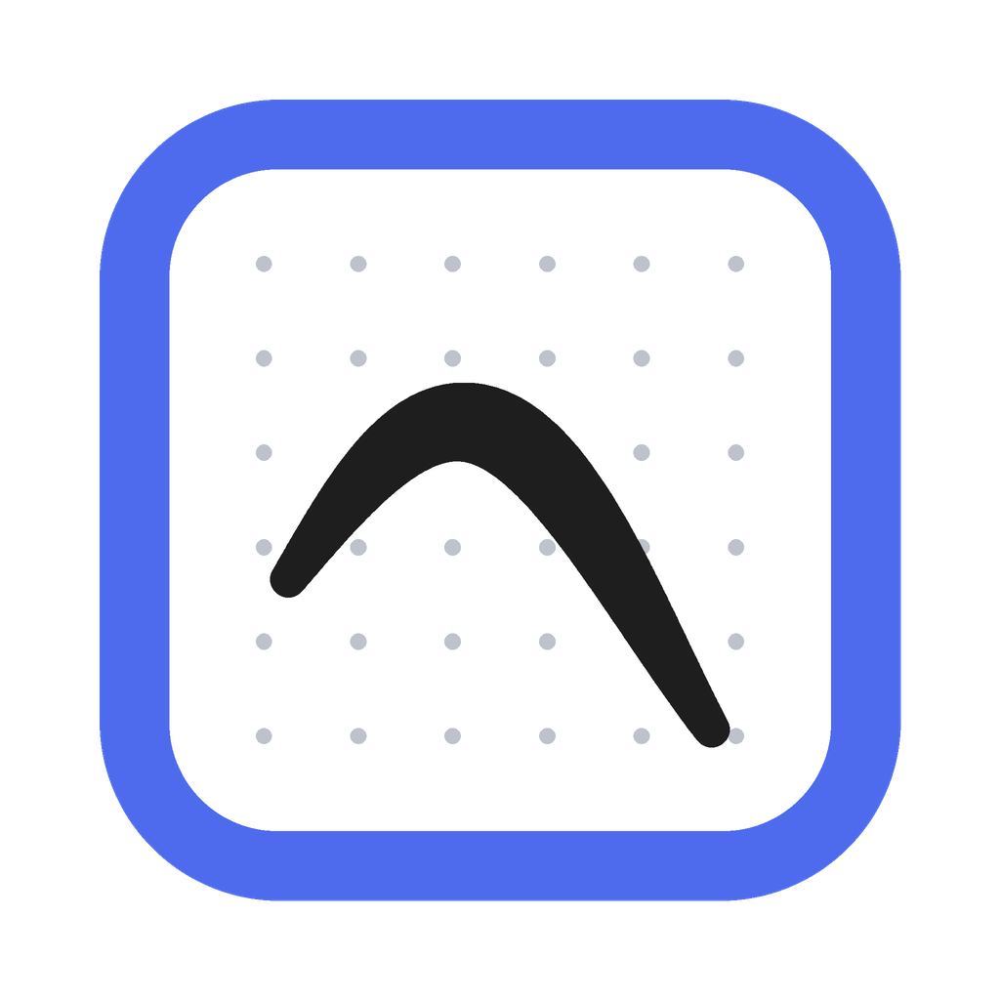
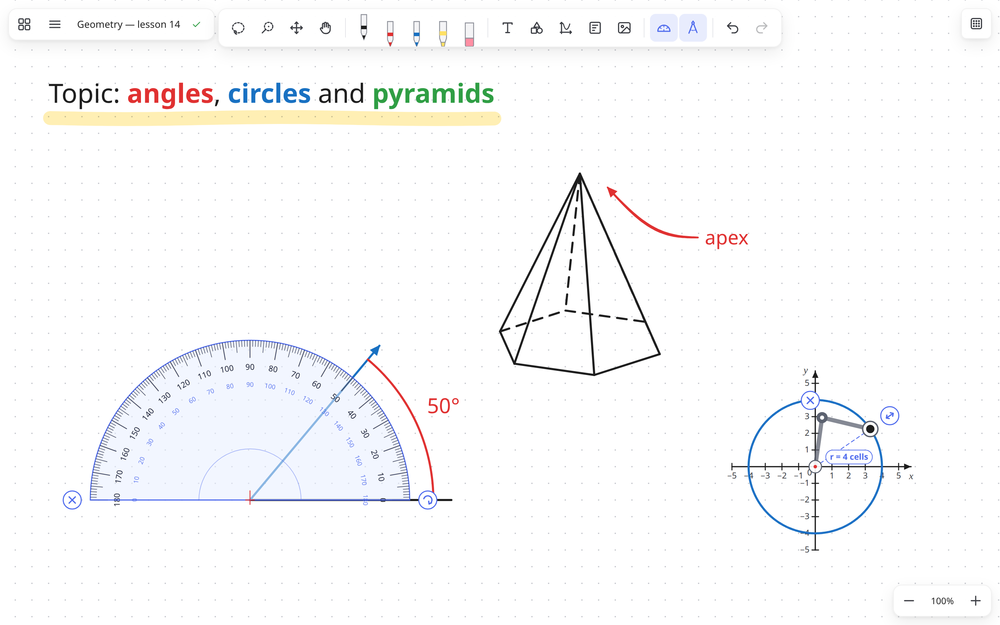
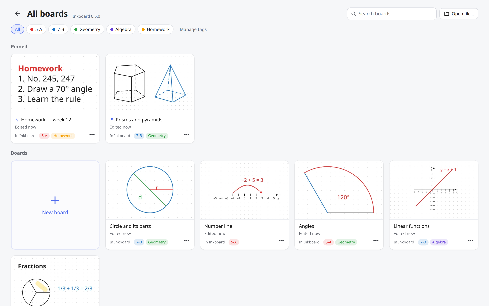

# Inkboard

**Безкоштовна дошка для вчителів, які пишуть і малюють графічним планшетом.** 
Нескінченна дошка, векторне чорнило з натиском, транспортир і циркуль, фігури й координатні осі для математики.

**[Сайт](https://yaroslavyushchenko.github.io/inkboard/)** ·
**[Завантажити](https://github.com/yaroslavyushchenko/inkboard/releases/latest)** ·
**[Гарячі клавіші](docs/SHORTCUTS.md)** ·
**[English](README.md)**

## Навіщо

Microsoft Whiteboard припиняє роботу, а багато вчителів працювали в ньому з графічним планшетом.
Inkboard такий самий простий (відкрив і пишеш), але має ще й інструменти, потрібні на уроці математики.
Працює без інтернету й без облікового запису, дошки зберігаються на вашому комп'ютері.

## Можливості

- **Нескінченна дошка**, векторне чорнило з натиском: лінії чіткі за будь-якого масштабу
- Ручки, маркер, гумка; працює гумка на кінці пера й кнопки пера; захист від долоні
- Папір: чистий, крапки, клітинка, лінійка
- **Транспортир**: кут від центру або дуга по краю, градуси підписуються самі
- **Циркуль**: радіус у клітинках, дуги й повні кола
- Фігури, піраміди й призми з **будь-якою кількістю кутів** основи; координатні прямі, площини й 3D-осі
- **Формули** з математичної клавіатури: дроби, корені, степені, інтеграли, матриці; для числових виразів результат з'являється за кнопкою «Показати відповідь», а функції та рівняння на кшталт `x² + y² = 4` будуються на координатній площині одним натиском (будь-яка назва і змінна, у вибраних межах по x та y, з осями, підігнаними під графіки)
- **Текст** просто на дошці: виділіть слова й змініть колір, розмір, жирний, курсив, підкреслення
- Картинки й скріншоти: Ctrl+V або перетягнути
- Виділення ласо і пензлем, групи, блокування, шаблони
- Екран **«Усі дошки»** з мініатюрами, пошуком, закріпленими дошками й кольоровими мітками

- **Робота не губиться:** кожна дошка зберігається сама за кілька секунд, навіть якщо вимкнуть світло
- Історія версій і «Нещодавно видалені» (30 днів), резервна папка (флешка, Google Диск / OneDrive)
- Експорт у PNG і PDF
- Автоматичні оновлення, інтерфейс українською та англійською

## Встановлення

Завантажте останню версію зі **[сторінки релізів](https://github.com/yaroslavyushchenko/inkboard/releases/latest)**:

| Система | Файл | Примітка |
|---|---|---|
| Windows 10 / 11 | `Inkboard-Setup-…-x64.exe` | Windows може попередити про невідомого видавця: **Докладніше → Усе одно запустити** |
| macOS | `Inkboard-…-mac-universal.dmg` | Програма ще не нотаризована Apple: якщо macOS не дає запустити, відкрийте **Системні параметри → Приватність і безпека → Усе одно відкрити** |
| Ubuntu та інші Linux зі snap | [Snap Store](https://snapcraft.io/inkboard) | Встановіть із Центру застосунків (пошук Inkboard) або командою `sudo snap install inkboard` |
| Linux | `Inkboard-…-x86_64.AppImage` або `.deb` | AppImage: у властивостях файлу дозвольте запуск як програми (або `chmod +x`) і відкрийте |

Далі на Windows, з AppImage і зі Snap Store Inkboard оновлюється сам; на macOS і з `.deb` повідомляє про нову версію.

## Планшети Wacom

- **Кнопки пера:** у Wacom Center задайте нижній кнопці *Правий клік*, а верхній *Середній клік*,
  а в Inkboard (Налаштування → Кнопки пера) виберіть, що вони роблять: гумка, ласо або поточний інструмент.
- **ExpressKeys** налаштовуються в Wacom Center як *Натискання клавіш…*, наприклад Ctrl+Z, X, V, M, пробіл.
  Повний список клавіш є в Налаштуваннях і в [docs/SHORTCUTS.md](docs/SHORTCUTS.md).

## Зворотний зв'язок

Знайшли помилку чи чогось бракує для уроків?
[Створіть issue](https://github.com/yaroslavyushchenko/inkboard/issues/new/choose), можна українською.

## Ліцензія

Inkboard є вільним програмним забезпеченням: [GPL-3.0-or-later](LICENSE).
